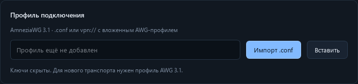
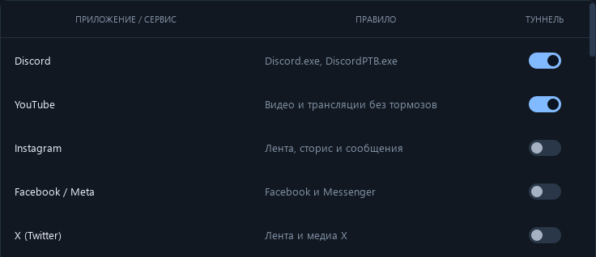
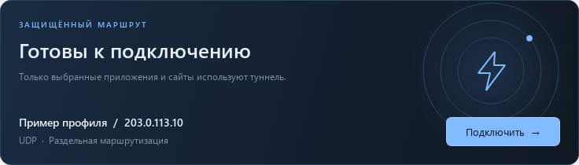

# Как подключить VEIL через AmneziaWG 3.1

Инструкция для Windows x64. VEIL направляет через VPN выбранные приложения и сервисы; остальной трафик идёт напрямую.

## 1. Получите свой файл .conf у «Вездехода»

**Нужен профиль AmneziaWG 3.1 именно файлом `.conf` от «Вездехода», у которого вы покупаете VPN.** Каждый использует свой файл конфигурации.

Получите файл в том боте или личном кабинете «Вездехода», где оформлена ваша подписка. Если не находите нужную выдачу, напишите в их поддержку:

> Нужен конфигурационный файл AmneziaWG 3.1 в формате .conf для подключения на Windows. Подскажите, как его получить для моей подписки.

Сохраните полученный файл на компьютер, например в «Загрузки». Пример имени: `my-vpn.conf`. Название может быть другим; важны протокол **AWG 3.1** и формат **`.conf`**.

## 2. Скачайте и запустите VEIL

- **[Скачать VEIL 2.0.2 для Windows x64 - ZIP](https://github.com/KashAlOt4SV/VlessBoost/releases/download/v2.0.2/VEIL-2.0.2-windows-x64.zip)**
- [Страница релиза на GitHub](https://github.com/KashAlOt4SV/VlessBoost/releases/tag/v2.0.2)
- [Эта инструкция в PDF](https://github.com/KashAlOt4SV/VlessBoost/releases/download/v2.0.1/VEIL-2.0.1-Quickstart-RU.pdf)

Распакуйте **весь архив**, откройте папку `VEIL` и запустите `VEIL.exe`. Оставьте папки `_internal` и `bin` рядом с EXE. Подтвердите запрос Windows на права администратора: они нужны для сетевого адаптера.

Если старая версия VEIL уже запущена, сначала завершите её через **значок в трее → Выход**. Обычный крестик может только скрыть окно.

## 3. Импортируйте файл от «Вездехода»

Откройте **Настройки → Импорт .conf**, выберите полученный файл и нажмите «Открыть» в окне выбора файла.

После успешного импорта появятся адрес вашего сервера и надпись **«Профиль AWG 3.1 проверен»**. Ключи в интерфейсе скрыты. Сохранять профиль отдельной кнопкой не нужно.

## 4. Выберите приложения и сервисы

Откройте **Маршрутизация** и включите переключатели в колонке **«Туннель»** для нужных приложений и сервисов. Голубой переключатель означает, что правило включено.

Для программы, которой нет в списке, нажмите **«+ Приложение»** и выберите её файл `.exe`.

Правила сохраняются автоматически. Если меняете выбор при уже включённом VPN, отключитесь и подключитесь снова.

## 5. Подключитесь

Перейдите на **Главную** и нажмите **«Подключить»**. Дождитесь статуса **«Вы подключены»**, затем откройте выбранное приложение или сайт.

На этом скриншоте показан демонстрационный профиль. У вас будут имя и адрес сервера из собственного `.conf`.

Если приложение было открыто до подключения и продолжает работать по-старому, полностью закройте его и откройте снова.

## Если не подключается

1. Уточните у «Вездехода», что файл выдан для **AmneziaWG 3.1**, и проверьте, что подписка активна.
2. Если одновременно включён другой VPN, отключите его и повторите попытку.
3. Откройте **Журнал событий → Экспорт .log** и приложите журнал вместе со скриншотом ошибки при обращении за помощью. Сам `.conf` содержит личные ключи - не публикуйте его в общем чате.

**Коротко:** получить у «Вездехода» свой **AWG 3.1 `.conf`** → скачать VEIL → импортировать файл → выбрать приложения → подключиться.
